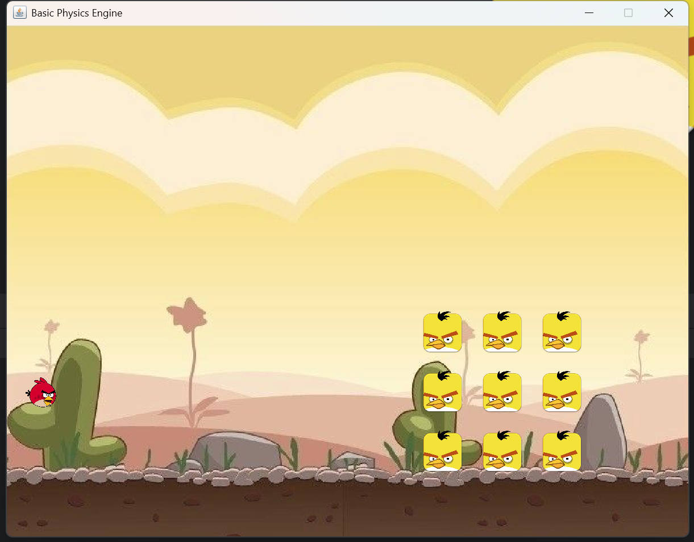
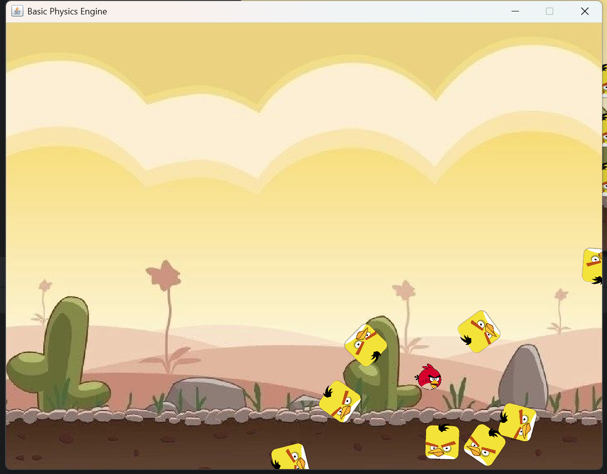

# oldHooliganTask

基于 **Java Swing / Java2D + JBox2D** 的《愤怒的小鸟》风格二维物理小游戏。通过鼠标拉动弹弓发射小鸟，撞击目标方块，观察重力、刚体碰撞与附近目标激活后的连锁运动。

项目包含游戏代码、JBox2D 源码与 JAR，以及课程要求和项目报告，适合用于学习二维物理引擎与桌面游戏开发。

## 效果预览

初始场景（仓库已有截图）：



运行效果（仓库已有截图）：



## 已实现功能

- **弹弓发射**：鼠标按下、拖拽蓄力、松开发射，限制最大拉伸距离。
- **二维物理模拟**：使用 JBox2D 处理重力、刚体运动、旋转、摩擦和碰撞。
- **目标连锁激活**：默认生成 3 × 3 个目标；小鸟接近目标时，将命中区域附近的静态目标切换为动态刚体。
- **鼠标拖动物体**：支持通过鼠标关节拖动动态刚体。
- **图像绘制**：使用 Swing 窗口和 Java2D 绘制背景、小鸟与弹弓。

当前版本是单场景物理演示，尚未实现完整的关卡、计分和胜负流程。

## 快速开始

### 环境要求

- **JDK 21**，需要同时提供 `java` 和 `javac`。
- 支持桌面图形界面的运行环境。
- 可选：IntelliJ IDEA。

仓库没有 Maven / Gradle 构建配置。JBox2D 源码位于 `src/org/jbox2d/`，以下命令直接编译全部源码，无需另外下载依赖或加入 JAR。

### 获取项目

```bash
git clone https://github.com/loks666/oldHooliganTask.git
cd oldHooliganTask
```

### Windows PowerShell

在项目根目录执行：

```powershell
$sources = Get-ChildItem src -Recurse -Filter *.java | ForEach-Object { $_.FullName }
javac -encoding UTF-8 -d out $sources
java -cp out pbgLecture5lab_wrapperForJBox2D.BasicPhysicsEngineUsingBox2D
```

### macOS / Linux

在项目根目录执行：

```bash
find src -name '*.java' > sources.txt
javac -encoding UTF-8 -d out @sources.txt
java -cp out pbgLecture5lab_wrapperForJBox2D.BasicPhysicsEngineUsingBox2D
rm sources.txt
```

### IntelliJ IDEA

1. 打开项目目录，将 Project SDK 设置为 JDK 21。
2. 将 `src` 标记为 **Sources Root**。
3. 运行 `BasicPhysicsEngineUsingBox2D.java` 中的 `main` 方法。
4. 将运行配置的 **Working directory** 设为项目根目录，以便加载 `resources/` 下的图片。

以上配置使用仓库内的 JBox2D 源码，不需要再添加根目录的 JAR。

## 操作方式

1. 在弹弓处按住鼠标，向后拖动小鸟，调整发射角度与拉伸距离。
2. 松开鼠标，小鸟沿拉伸的反方向发射。
3. 尝试撞击右侧目标，观察附近目标被激活后的运动与碰撞。
4. 如需重新尝试，关闭窗口并重新运行程序；当前不会自动补充小鸟。

## 项目结构

```text
oldHooliganTask/
├── src/
│   ├── pbgLecture5lab_wrapperForJBox2D/  # 游戏、渲染、输入与物理包装层
│   └── org/jbox2d/                      # 随仓库提供的物理引擎源码
├── resources/imgs/                     # 背景、小鸟、弹弓等图片
├── doc/
│   ├── report.md                       # 项目报告
│   ├── report.pdf                      # PDF 报告
│   ├── descript_cn.md                  # 中文课程要求
│   └── descript_en.md                  # 英文课程要求
├── jbox2d-library-2.2.1.1.jar            # 随仓库提供的 JBox2D JAR
├── init.png                            # 初始场景截图
└── result.png                          # 运行效果截图
```

主要代码入口：

- [BasicPhysicsEngineUsingBox2D.java](src/pbgLecture5lab_wrapperForJBox2D/BasicPhysicsEngineUsingBox2D.java)：程序入口、场景创建、物理更新和目标激活判定。
- [Slingshot.java](src/pbgLecture5lab_wrapperForJBox2D/Slingshot.java)：装载小鸟、限制拉伸距离与设置发射速度。
- [AngryBird.java](src/pbgLecture5lab_wrapperForJBox2D/AngryBird.java)：小鸟对象。
- [Pig.java](src/pbgLecture5lab_wrapperForJBox2D/Pig.java)：目标方块、静态与动态状态切换及绘制。
- [BasicMouseListener.java](src/pbgLecture5lab_wrapperForJBox2D/BasicMouseListener.java)：弹弓交互与鼠标拖动物体。
- [BasicView.java](src/pbgLecture5lab_wrapperForJBox2D/BasicView.java)：场景渲染。

## 物理参数与实现说明

可在主类和 `Slingshot.java` 中调整以下参数：

- 重力：`GRAVITY = 20.0f`。
- 固定物理步长：`DELTA_T = 0.02` 秒；绘制循环每次额外休眠 `20` 毫秒，实际帧率受执行耗时影响。
- 速度与位置求解迭代次数：均为 `10`。
- 弹弓最大拉伸距离：`2.0` 个世界单位。
- 发射初速度：方向指向弹弓中心，大小为拉伸距离的 `25` 倍，通过 `setLinearVelocity` 设置。
- 小鸟与目标的激活判定距离：小于 `1.0` 个世界单位；附近目标的连锁激活范围为小于 `2.0` 个世界单位。

目标激活逻辑使用中心距离阈值判定，并为激活的目标赋予小幅随机初速度，因此每次运行的效果可能不同。

## 当前限制与常见问题

- **缺少木块贴图**：代码引用 `resources/imgs/blocks/wood_block.png`，但当前仓库未包含该文件。运行时会输出加载失败信息，并回退到默认多边形绘制；控制台也可能持续输出图片为空的提示。
- **图片无法加载**：确认从项目根目录启动，或检查 IDEA 的 Working directory 配置。
- **只有一次发射机会**：默认只装载一只小鸟，发射后不会自动装载下一只，重新运行可重置场景。
- **没有完整通关判定**：目标的销毁状态接口已存在，但当前主循环未实现自动销毁、计分或胜负判断。
- **目标名称与显示有差异**：`Pig` 当前按方块目标实现，加载的是木块贴图路径，未使用仓库中的 `pigs/pig.png`。
- **编译警告**：JDK 21 下编译随附的 JBox2D 源码会出现旧 API 相关警告，不影响本次编译通过。

## 文档与来源

- [项目报告（Markdown）](doc/report.md) / [项目报告（PDF）](doc/report.pdf)
- [中文课程要求](doc/descript_cn.md) / [英文课程要求](doc/descript_en.md)

部分物理包装层和 GUI 代码保留了课程示例作者 Michael Fairbank 的署名；JBox2D 源码保留其原有版权与许可声明。项目报告中的部分素材来源仍为占位信息，仓库当前未提供项目级 `LICENSE`，使用或分发前请核实相关代码与素材的授权。

## 联系与贡献

- 联系邮箱：**super_xiang@126.com**
- 欢迎提交 Issue 反馈问题，也欢迎通过 Pull Request 修复 Bug、补充功能或改进文档。
